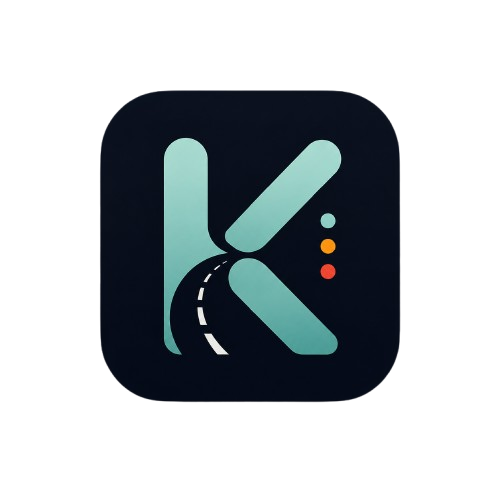

<div align="center">
  
  
  # Project Kinetica
  
  **Autonomous Cyber-Physical Traffic Actuation, Multi-Class Edge Perception & Graph-Based Corridor Preemption**

  [](https://www.python.org/)
  [](https://fastapi.tiangolo.com/)
  [](https://nextjs.org/)
  [](https://ultralytics.com/)
  [](tests/)
  [](LICENSE)

  <p align="center">
    <b>A closed-loop cyber-physical system replacing static, fixed-timer traffic intersections with real-time perception-driven, statistically-modeled, priority-aware actuation.</b>
  </p>

  <p align="center">
    <sub>Open-Source Project • Built by <b>Vaibhav P.K</b> & <b>Mithil Girish</b></sub>
  </p>
</div>

---

## 📖 Table of Contents
- [Overview](#-overview)
- [System Architecture](#-system-architecture)
- [Module Breakdown](#-module-breakdown)
- [Repository Structure](#-repository-structure)
- [Quick Start Guide](#-quick-start-guide)
  - [1. Backend & Perception Setup](#1-backend--perception-setup)
  - [2. Next.js Control Room Setup](#2-nextjs-control-room-setup)
- [Verification & Testing](#-verification--testing)
- [Success Criteria (SC1–SC4)](#-success-criteria-sc1sc4)
- [Documentation & Guides](#-documentation--guides)
- [License](#-license)

---

## 🌟 Overview

Modern urban traffic controllers predominantly rely on fixed-time cycle plans that cannot respond to stochastic demand surges or facilitate emergency vehicle clearance. **Project Kinetica** replaces these legacy systems with a closed-loop cyber-physical traffic control platform designed for complex heterogeneous traffic environments:

- **Perception-Driven Queue Estimation:** Fine-tuned YOLOv8 neural detector trained on 7,534 images across 5 traffic datasets, augmented with heterogeneous vehicle classes (Auto-Rickshaws, City Buses, Motorcycles).
- **MoRTH AIS-125 Livery Decomposition:** Heuristic HSV colour-space decomposition that cross-examines vehicle livery against emergency vehicle standards to prevent red-car false positives.
- **Dynamic Green Phase Optimization:** Demand-responsive actuation utilizing arrival rate estimation ($\lambda$) and Webster's kinematic delay formulation.
- **Graph-Based Corridor Preemption:** Local $O(\log n)$ max-heap priority queueing paired with directed acyclic graph (DAG) lookahead routing to clear multi-intersection "green waves" for ambulances and emergency services.
- **Statistical Analytics & Bottleneck Modeling:** Empirical Mann-Whitney U hypothesis testing proving significant delay reductions over fixed-timer baselines alongside regression-tree bottleneck forecasting.

---

## 🏗️ System Architecture

Kinetica adheres to an immutable schema contract (`schemas/lane_state.py`). No module produces ad-hoc or unvalidated payloads; all inter-module communications use strict Pydantic models:

```
                      +-----------------------------+
                      |     CCTV Video Streams      |
                      |   (4 Approach Cameras)      |
                      +--------------+--------------+
                                     |
                                     v
                      +-----------------------------+
                      |       VISION MODULE         |
                      | - YOLOv8 Bounding Boxes     |
                      | - MoRTH AIS-125 Livery Clf  |
                      | - Homography Queue Density  |
                      +--------------+--------------+
                                     |
                 LaneObservation & PriorityEvent
                                     |
                +--------------------+--------------------+
                |                                         |
                v                                         v
+-------------------------------+         +-------------------------------+
|       ACTUATION MODULE        |         |       PREEMPTION MODULE       |
| - Arrival Rate Estimator (λ)  |         | - Max-Heap Priority Queue     |
| - Proportional Allocation     |         | - Anti-Starvation Aging       |
| - Webster Minimum Split Engine|         | - Multi-Hop Corridor Router   |
+---------------+---------------+         +---------------+---------------+
                |                                         |
                +--------------------+--------------------+
                                     |
                               PhaseDecision
                                     |
                +--------------------+--------------------+
                |                                         |
                v                                         v
+-------------------------------+         +-------------------------------+
|      FASTAPI EDGE GATEWAY     |         |       ANALYTICS ENGINE        |
| - Relay Hardware Actuator     |         | - Poisson Fit Validation (χ²) |
| - Sub-33ms Execution Loop     |         | - Mann-Whitney U Test (SC4)   |
| - REST & Telemetry Endpoints  |         | - Bottleneck Decision Tree    |
+---------------+---------------+         +---------------+---------------+
                |
                v
+-------------------------------+
|     KINETICA CONTROL ROOM     |
| - Live 4-Way Approach Feeds   |
| - Tactical Map & Green Waves  |
| - Manual Emergency Override   |
+-------------------------------+
```

---

## 🧩 Module Breakdown

| Module | Core Responsibilities | Technology Stack |
|---|---|---|
| **`schemas/`** | Foundation data contracts (`LaneObservation`, `PriorityEvent`, `PhaseDecision`). | Python, Pydantic v2 |
| **`vision/`** | Real-time object detection, Indian traffic vehicle taxonomy, homography projection, priority vehicle verification. | YOLOv8, OpenCV, NumPy |
| **`actuation/`** | Poisson arrival estimation, proportional split scheduling, green gap extension, hardware relay driver. | SciPy, Python |
| **`preemption/`** | $O(\log n)$ max-heap event ordering, dynamic aging, directed-graph corridor routing for downstream signals. | Python, NetworkX/Graph |
| **`analytics/`** | Empirical hypothesis testing (Mann-Whitney U), Gini feature importance bottleneck modeling, figure rendering. | Scikit-learn, SciPy, Matplotlib |
| **`backend/`** | Edge gateway daemon, sub-33ms actuation loop, REST endpoints for dashboard observability. | FastAPI, Uvicorn |
| **`frontend/`** | Production "Control Room" operations dashboard, live camera feeds, GIS map tiles, manual override triggers. | Next.js 16, React 19, Tailwind CSS |

---

## 📂 Repository Structure

```
Kinetica/
├── actuation/               # Demand-responsive traffic actuation algorithms & strategies
│   ├── arrival_model.py     # Poisson arrival rate estimation & Chi-square goodness-of-fit
│   ├── engine.py            # Phase scheduler & dynamic green duration allocation
│   ├── hardware_relay.py    # GPIO/Relay physical actuator interface
│   └── strategies/          # Proportional, gap extension, and phase-skipping strategies
├── analytics/               # Statistical validation & bottleneck modeling
│   ├── bottleneck_model.py  # Decision tree regression & Gini feature importance
│   ├── hypothesis_test.py   # Mann-Whitney U & Welch's t-test comparative harness
│   └── generate_plots.py    # Publication-ready figure generator
├── backend/                 # FastAPI entrypoints
│   └── main.py              # Production ASGI backend server
├── benchmarks/              # Edge latency & heap performance benchmarks
├── data/                    # Synthetic generator & spatial ROI calibration
│   ├── calibration/         # Camera perspective homography & ROI definitions
│   └── synthetic_generator.py # Deterministic multi-scenario event generator
├── docs/                    # Technical manuals and training guides
│   ├── COLAB_TRAINING_GUIDE.md
│   ├── MODEL_PLAN.md
│   └── MODEL_TRAINING_AND_DATASET_PIPELINE.md
├── frontend/                # Next.js 16 Control Room dashboard
│   ├── src/app/             # Next.js App Router & API routes
│   └── src/components/      # Tactical overview, video monitors, and GIS map views
├── notebooks/               # Google Colab cloud training notebooks
│   └── Train_Kinetica_YOLOv8_Colab.ipynb
├── preemption/              # Emergency preemption & corridor green waves
│   ├── heap.py              # Thread-safe max-heap with priority escalation
│   ├── graph_router.py      # Directed graph multi-intersection corridor pre-clearance
│   └── override.py          # State-machine interrupt handler
├── results/                 # Empirical experiment results, logs, and figures
│   ├── figures/             # High-resolution benchmark and telemetry plots
│   └── *.json               # Test results, telemetry logs, and benchmark metrics
├── schemas/                 # Canonical Pydantic data schemas (LaneObservation, etc.)
├── scripts/                 # Utility scripts (video generators, webcam benchmarks, false positive tests)
├── tests/                   # End-to-end integration tests & FastAPI client tests
├── vision/                  # Perception engine, model zoo, tracker, and classification
├── weights/                 # Model checkpoints (best.pt, best.onnx, yolov8n.onnx)
├── edge_gateway.py          # Standalone FastAPI Edge Actuation Gateway
├── run_end_to_end.py        # Complete end-to-end simulation runner
├── requirements.txt         # Pinned Python package dependencies
└── LICENSE                  # MIT Open Source License
```

---

## 🚀 Quick Start Guide

### 1. Backend & Perception Setup

Ensure you have Python 3.10+ installed:

```bash
# Clone the repository
git clone https://github.com/your-username/Kinetica.git
cd Kinetica

# Create and activate virtual environment
python -m venv .venv

# Windows
.\.venv\Scripts\activate
# Linux/macOS
source .venv/bin/activate

# Install dependencies
pip install -r requirements.txt

# Run the complete end-to-end simulation
python run_end_to_end.py
```

To start the FastAPI Edge Gateway service:
```bash
python -m uvicorn edge_gateway:app --host 0.0.0.0 --port 8000 --reload
```
API Documentation will be live at `http://127.0.0.1:8000/docs`.

### 2. Next.js Control Room Setup

Ensure Node.js 18+ is installed:

```bash
cd frontend

# Install dependencies
npm install

# Start development server
npm run dev
```

Open [http://localhost:3000](http://localhost:3000) in your browser to interact with the Kinetica Control Room dashboard.

---

## 🧪 Verification & Testing

Project Kinetica includes an exhaustive test suite covering unit logic, mathematical guarantees, schema serialization, and API endpoints:

```bash
# Execute all 127 automated tests
pytest -v

# Run tests with execution duration profiling
pytest --durations=10
```

---

## 🏆 Success Criteria (SC1–SC4)

All four foundational research claims are empirically verified via automated Pytest gates:

| ID | Assertion | Pytest Validation Gate | Status |
|---|---|---|:---:|
| **SC1** | Green phase duration dynamically scales with observed queue length (non-constant). | `actuation/tests/test_engine.py::test_green_duration_scales_with_queue` | ✅ PASS |
| **SC2** | Detected priority vehicle preempts phase ordering ahead of standard FIFO/queue order. | `preemption/tests/test_heap.py::test_priority_event_forces_root` | ✅ PASS |
| **SC3** | Emergency vehicle route projection pre-clears $>1$ downstream corridor intersections. | `preemption/tests/test_graph_router.py::test_multi_intersection_preclear` | ✅ PASS |
| **SC4** | Paired wait-time distributions reject the null hypothesis ($H_0$) at $\alpha = 0.05$. | `analytics/tests/test_hypothesis_test.py::test_h0_rejected_at_alpha_05` | ✅ PASS |

---

## 📚 Documentation & Guides

Comprehensive technical manuals are located in the [`docs/`](docs/) directory:
- 📘 [Edge Traffic Perception & Dataset Training Pipeline](docs/MODEL_TRAINING_AND_DATASET_PIPELINE.md)
- 🚀 [Google Colab Cloud GPU Training Guide](docs/COLAB_TRAINING_GUIDE.md)
- 🗂️ [Class Taxonomy & Dataset Plan](docs/MODEL_PLAN.md)
- 📋 [Core System & Schemas Specification](build-spec.md)

---

## 📄 License

This project is open-source and distributed under the terms of the [MIT License](LICENSE).
